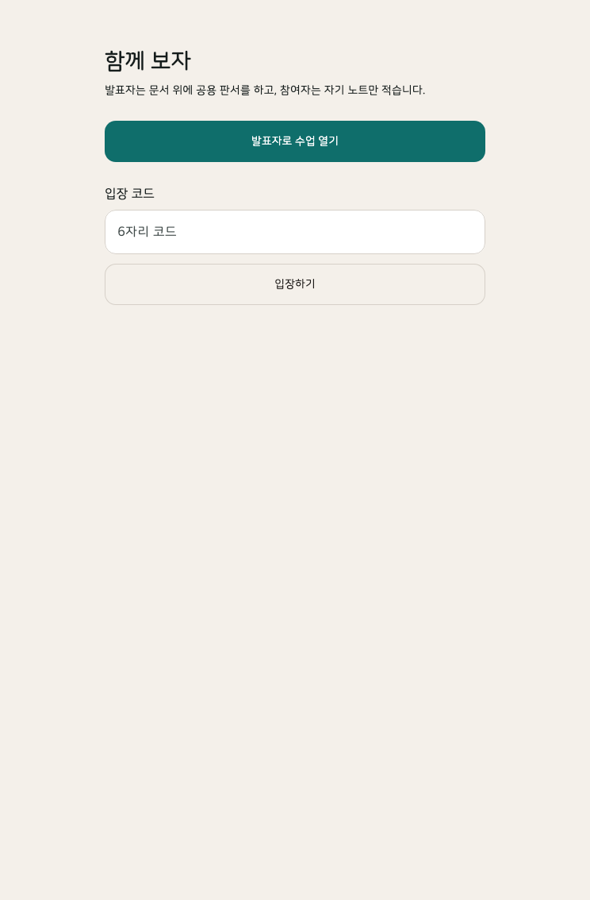
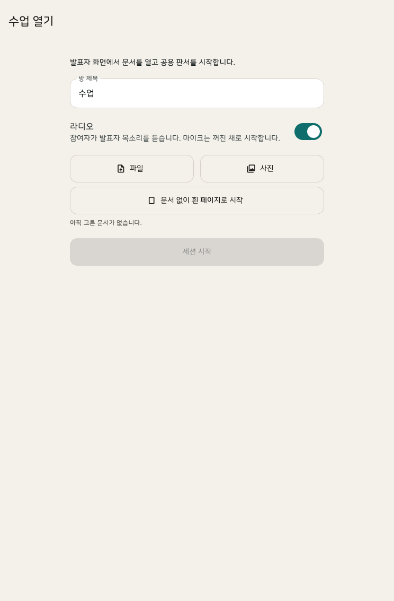
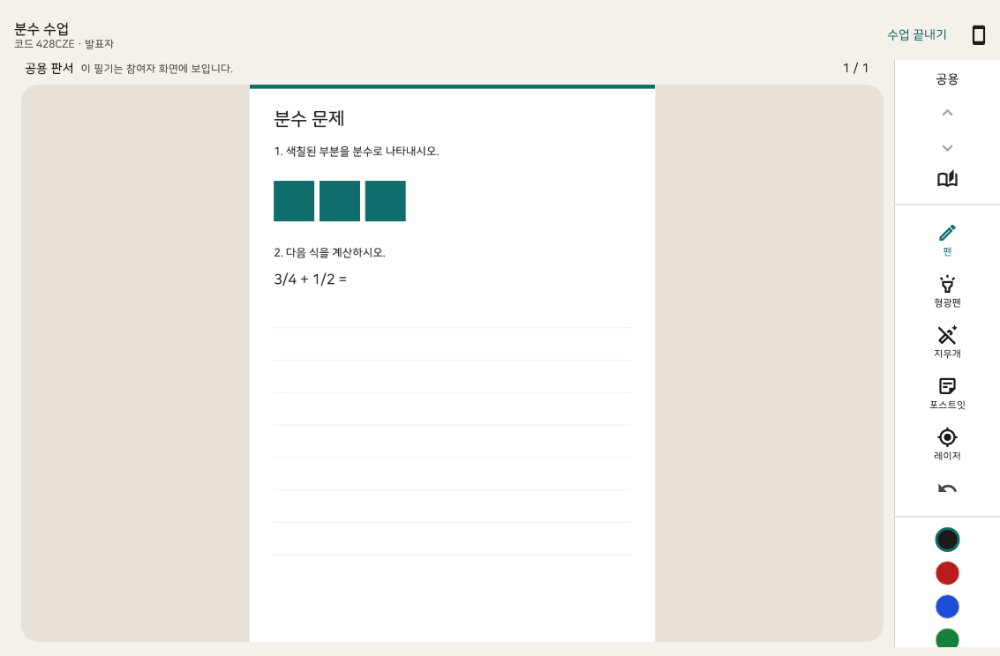
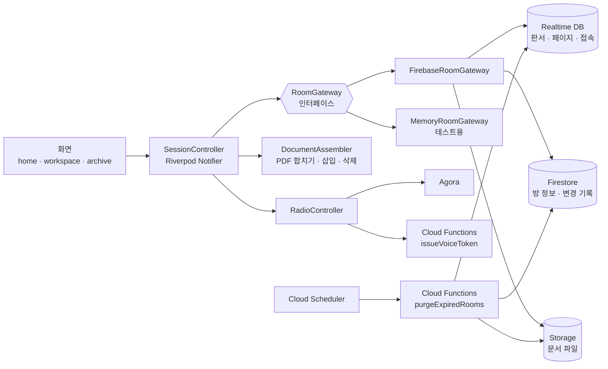

# 함께 보자 (Together View)

> 발표자는 문서 위에 판서하고, 참여자는 그 화면을 실시간으로 보면서 **자기만의 노트**를 따로 적는 수업·발표용 협업 앱

Flutter · Firebase · Agora 기반의 iPad / iPhone 앱입니다. 발표자 한 명이 문서를 띄우고 6자리 입장 코드를 알려 주면, 참여자는 같은 문서와 발표자의 판서를 실시간으로 보면서 자기 기기에만 남는 개인 필기를 할 수 있습니다. 수업이 끝나면 공용 판서와 내 노트를 합친 PDF를 기기에 남겨 공유할 수 있습니다.

| 홈 | 수업 열기 | 수업 화면 (가로) |
| :---: | :---: | :---: |
|  |  |  |

---

## 주요 기능

**문서와 판서**
- PDF, 사진 여러 장, 또는 빈 화이트보드로 수업 시작
- 수업 중 사진·파일을 맨 뒤에 덧붙이기, 현재 페이지 뒤에 흰 페이지 끼워 넣기, 페이지 삭제(발표자 전용)
- 펜 · 형광펜 · 지우개 · 포스트잇 · 레이저 포인터, 색상과 굵기 선택
- 두 손가락 스와이프로 페이지 넘기기(펜슬 사용 중에는 무시), 방향을 따라 미끄러지는 전환 애니메이션

**공용 판서와 개인 노트**
- 공용 판서는 발표자만 쓸 수 있고, 모든 참여자 화면에 실시간으로 보입니다.
- 참여자의 필기는 개인 레이어로 그 기기에만 저장됩니다.
- 페이지가 삽입·삭제되면 공용 판서와 개인 노트가 맞는 페이지로 함께 이동합니다.

**수업 진행**
- 참여자는 "발표자 따라가기"를 켜고 끌 수 있어서, 필기할 시간이 필요하면 혼자 페이지를 넘겨 볼 수 있습니다.
- 발표자는 "모두 내 페이지로" 버튼으로 참여자 전원을 자기 페이지로 불러올 수 있습니다.
- 실시간 접속자 수, 발표자 부재 알림(나가거나 연결이 끊기면 참여자에게 표시)
- 라디오 모드: 발표자 음성을 참여자에게 송출(수업 만들 때 켜기/끄기)

**수업 수명과 기록**
- 첫 참여자가 들어온 시점부터 24시간 동안 열리고, 이후에는 발표자만 입장할 수 있습니다. 발표자에게 남은 시간을 보여 줍니다.
- 수업 끝내기를 누르면 공용 판서와 내 노트를 합친 PDF를 기기에 저장하고 공유할 수 있습니다.
- 만료되거나 방치된 방은 서버에서 자동으로 정리됩니다.

## 기술 스택

| 영역 | 사용 기술 |
| --- | --- |
| 앱 | Flutter 3.44 / Dart 3.12, Riverpod 3 (Notifier) |
| 문서 | pdfrx (PDF 렌더링·페이지 편집), pdf (이미지→PDF, 기록 PDF 생성), file_picker |
| 실시간 동기화 | Firebase Realtime Database (판서·페이지·접속 상태), Cloud Firestore (방 정보·문서 변경 기록) |
| 파일 | Cloud Storage for Firebase |
| 인증 | Firebase Authentication (익명 로그인) |
| 서버 | Cloud Functions 2세대 (Node.js 22) — 음성 토큰 발급, 예약 정리 작업 |
| 음성 | Agora RTC |

## 아키텍처



- **화면**은 `SessionController`의 상태(`Session`)만 보고 그립니다. 판서 입력, 페이지 이동, 문서 변경, 원격 이벤트 반영이 모두 컨트롤러에 모여 있습니다.
- **서버 접근**은 `RoomGateway` 인터페이스 뒤에 숨겼습니다. 실제 앱은 Firebase 구현을, 테스트는 메모리 구현을 끼워 넣어 여러 기기가 한 방에 들어온 상황을 기기 없이 재현합니다.

## 설계에서 신경 쓴 부분

### 1. 페이지를 추가할 때 문서 전체를 다시 보내지 않기
문서를 바꿀 때마다 합친 PDF를 통째로 올리고 받으면 페이지가 늘수록 느려집니다. 그래서 처음 올린 원본은 그대로 두고, Firestore에 **변경 기록(op log)** 만 쌓습니다.

- `blank`(흰 페이지 삽입), `append`(덧붙인 부분만 업로드), `delete`(페이지 삭제) 세 종류
- 각 기기는 받은 기록을 원본에 차례로 다시 적용(replay)해서 같은 문서를 만듭니다.
- 흰 페이지 삽입과 삭제는 업로드·다운로드가 전혀 없습니다.
- 참여자는 실시간 DB의 문서 버전 신호만 보고 바뀐 부분을 받아 오고, 그동안 화면 조작을 잠시 막는 로딩 상태를 보여 줍니다.

### 2. 페이지가 밀리고 당겨질 때 필기 위치 지키기
페이지 삽입·삭제는 `PageShift`(위치, ±장수)라는 하나의 모델로 표현합니다. 공용 판서, 개인 노트, 참여자가 혼자 보던 페이지 번호가 모두 같은 함수로 이동하고, 삭제된 페이지의 필기는 정리됩니다. 수업 중 나가 있던 참여자도 다시 들어오면 저장해 둔 문서 버전부터 기록을 따라가서 노트가 맞는 페이지로 돌아옵니다.

### 3. 권한은 앱이 아니라 서버 규칙으로 강제하기
- 공용 판서, 페이지, 문서 변경은 보안 규칙상 발표자(`hostUid`)만 쓸 수 있습니다.
- 수업 24시간 타이머의 시작 시각은 `!data.exists() && newData.val() == now` 규칙으로 **서버 시각으로 한 번만** 기록되게 막았습니다. 기기 시계를 바꾸거나 다시 들어와서 기간을 늘릴 수 없습니다.
- 만료된 방은 Realtime DB 규칙이 직접 막고, Firestore·Storage 규칙은 DB를 읽을 수 없어서 첫 입장 때 Cloud Function이 방 문서에 만료 시각(`expiresAt`)을 복사해 같은 기준으로 막습니다. 만료 뒤에는 앱을 거치지 않아도 발표자 외에는 판서·문서·음성에 접근할 수 없습니다.
- 음성 송출 권한은 Cloud Function이 방의 발표자인지 확인한 뒤 토큰에 담아 줍니다. Agora 인증서는 Secret Manager에만 있습니다.

### 4. 실시간 판서를 가볍게
- 좌표는 페이지 크기 기준 0~1로 정규화해서 기기 화면 크기와 무관하게 같은 위치에 그립니다.
- 그리는 중인 선(live)은 일정 간격으로 묶어서 보내고, 손을 떼면 확정 판서로 한 번 저장합니다.
- 발표자가 그리다 앱이 꺼져도 다시 들어오면 그리던 선을 이어서 복구합니다.

### 5. 접속 상태와 발표자 부재
실시간 DB의 접속 목록(presence)과 `onDisconnect`로 접속자 수를 셉니다. 발표자가 뒤로 가기로 화면을 나가거나 연결이 끊기면 참여자 화면에 회색 안내가 뜨고, 돌아오면 사라집니다.

### 6. 서버 정리 자동화
`purgeExpiredRooms` 예약 함수가 1시간마다 실행됩니다.
- 참여자가 들어왔던 방: 첫 입장 후 24시간 + 유예 2일이 지나면 정리
- 참여자가 한 번도 오지 않은 방: 발표자가 마지막으로 들어온 지 7일이 지나면 정리(발표자가 미리 준비하는 기간)

정리는 문서 파일, 방 정보, 실시간 데이터 순서로 지웁니다. 실시간 데이터를 마지막에 지우기 때문에 중간에 실패해도 다음 실행 때 다시 시도됩니다.

## 프로젝트 구조

```
lib/
├── features/        # 화면: 홈, 수업 만들기, 수업 화면(문서·판서·도구)
├── state/           # SessionController — 앱 상태와 동작의 중심
├── models/          # Session, Stroke, 문서 변경 기록(PageShift/DocumentOp), 남은 시간 표기
├── sync/            # RoomGateway 인터페이스, Firebase/메모리 구현, 개인 노트 저장소
├── documents/       # PDF 합치기·흰 페이지 삽입·페이지 삭제, 파일/사진 선택
├── radio/           # Agora 음성(라디오 모드)
├── archive/         # 수업 기록 PDF 만들기·목록·공유
└── theme/           # 테마, 기기 형태(폰/태블릿, 가로/세로) 판단
functions/           # Cloud Functions: 음성 토큰 발급, 방 자동 정리 (+ node:test 테스트)
test/                # 단위·위젯 테스트 (여러 기기 시나리오 포함)
*.rules(.json)       # Firestore / Realtime DB / Storage 보안 규칙
```

## 실행 방법

### 준비물
- Flutter 3.44 이상, Xcode(실기기 실행 시)
- Firebase 프로젝트(Authentication 익명 로그인, Firestore, Realtime Database, Storage, Functions 사용 — Functions는 Blaze 요금제 필요)
- Agora 프로젝트(App ID, App Certificate)

### 설정
```bash
# 1. 의존성
flutter pub get
(cd functions && npm install)

# 2. Firebase 앱 설정 파일 생성 (저장소에는 포함하지 않음)
#    lib/firebase_options.dart, ios/Runner/GoogleService-Info.plist,
#    android/app/google-services.json 이 만들어집니다.
flutterfire configure

# 3. 보안 규칙과 서버 함수 배포
firebase functions:secrets:set AGORA_APP_CERTIFICATE
firebase deploy --only firestore:rules,database,storage,functions
```
Agora App ID는 `functions/index.js`와 `lib/radio/agora_app.dart`에서 바꿉니다.

### 실행
```bash
flutter run                      # 개발 실행
flutter build ios --profile      # 실기기 성능 확인용 빌드
```

## 테스트

```bash
flutter test                     # 앱 단위·위젯 테스트
(cd functions && npm test)       # 서버 함수 테스트
```

메모리 게이트웨이 덕분에 발표자와 참여자 여러 명이 한 방에 들어온 상황을 기기 없이 테스트합니다. 예를 들면 다음과 같은 시나리오입니다.
- 페이지 삽입·삭제 후 공용 판서와 개인 노트 위치
- 참여자가 혼자 보다가 발표자에게 불려 오는 흐름
- 발표자 부재 표시
- 24시간 만료 후 입장 차단
- 두 손가락 스와이프와 펜슬 구분

`CAPTURE_SCREENS=1 flutter test test/capture_screens_test.dart`로 위 스크린샷을 다시 만들 수 있습니다.

## 앞으로 할 일
- 링크로 바로 입장(앱이 없으면 스토어로 연결)
- 앱 설치 없이 참여하는 웹 뷰어
- 앱 이름·문구·아이콘 다듬기
